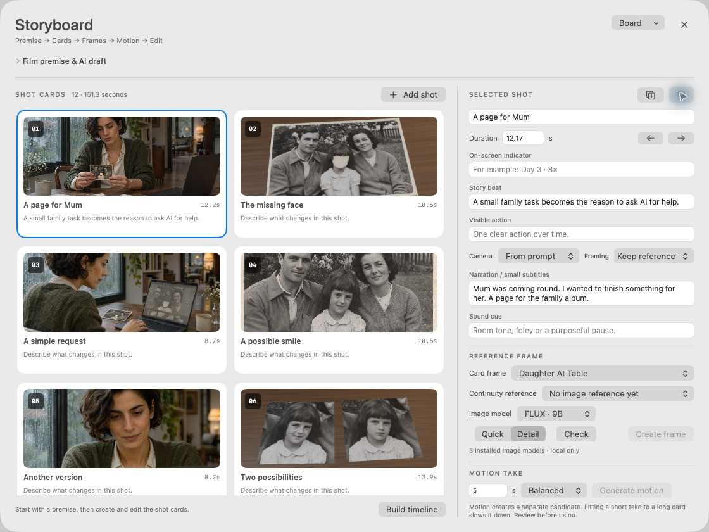

# Stillroom Studio

A native Mac workspace for storyboards, local AI motion, small Blender inserts and edited sound.

[Download the Mac app](https://github.com/RyanYu0410/Stillroom-Studio/releases/latest) · [User guide](docs/User-Guide.md) · [Developer guide](docs/Developer-Guide.md)

## From a premise to a film

1. Create a storyboard with an installed local chat model, or write cards yourself.
2. Edit and reorder shot purpose, action, camera, duration, narration and sound cues.
3. Generate reference frames locally and keep a shared character/location reference.
4. Build a picture timeline with editable day/scene indicators and provisional subtitles.
5. Generate short motion takes, review them at normal speed, then fit selected footage to the edit.
6. Add narration and sound recordings, import timed subtitles, then export an MP4 or portable project.

The Edit Assistant proposes concrete changes before applying a single undoable group. Blender assist builds an editable photo-card scene with a controlled camera and packed texture. Reference images and generated takes remain in the library.



## Requirements

The included Apple-silicon development app runs on macOS 14 or later. It is signed locally, not notarized for general distribution. The editor and export work without a model server. AI functions use models already installed in Ollama, MLX Core or the supported local ComfyUI/MLX video environment. No model weights, API keys, subscriptions or cloud generation are included. Local rendering performance depends on the installed model and Mac memory.

Build from source with Xcode 26 or later and its macOS 26 SDK (the app retains runtime availability checks for older supported systems):

```sh
swift test
./build.sh
```

The build script creates `../Stillroom Studio.app` and signs it ad hoc. The release download includes the app, source, guides and example media. The repository includes the original demonstration resources so the native export tests run from a clean checkout.

## Scope

The text assistant reads timeline metadata; it does not watch or hear footage. Generated images and motion require human review. Storyboard narration cues are provisional until recorded speech is aligned. AI motion is anchored image-to-video generation, not frame-exact video-to-video preservation. Blender assist is a photo card in 3D rather than automatic reconstruction of a photographed scene. A new storyboard does not overwrite an independent edit or existing sound mix.

Demo recordings and their treatment are documented in [Sound credits](Resources/Demo/Sound-credits.md). External inference tools and model weights keep their own licenses. No MLX-Serve code, brand assets or model weights are bundled.
